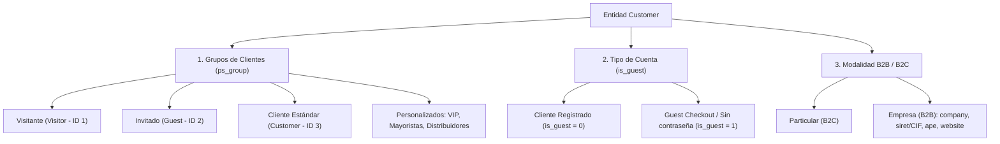

# Plan y Documentación: Notificaciones de Registro, Compras y Clasificación de Clientes

## 1. Aclaración del Entorno

Todos los cambios descritos a continuación están realizados en este proyecto local (`/home/luis/Documentos/bridgePrestashop/bridgeprestashop`).

---

## 2. Clasificación de Tipos de Clientes en PrestaShop

PrestaShop categoriza a los clientes en varias dimensiones complementarias:



---

## 3. Resumen de Archivos Creados y Modificados en el Proyecto

| Archivo | Estado | Qué hace |
| :--- | :--- | :--- |
| `src/DTO/PayloadInterface.php` | **[NUEVO]** | Contrato común para estandarizar serialización y eventos de webhooks (`toArray`, `toJson`, `getEventName`, `getEventId`). |
| `src/DTO/CustomerPayload.php` | **[NUEVO]** | DTO para el evento `customer.created`. Serializa datos personales, de empresa (B2B), `is_guest`, grupo por defecto y grupos asociados. |
| `src/Handler/CustomerEventHandler.php` | **[NUEVO]** | Handler que captura el hook `actionCustomerAccountAdd` con protección `try/catch` para despachar el webhook sin afectar la tienda. |
| `src/DTO/OrderPayload.php` | **[MODIFICADO]** | Implementa `PayloadInterface` y enriquece la sección `customer` con `is_guest`, `default_group`, `groups`, `company`, `siret`, `ape` y `website`. |
| `src/HttpClient/WebhookSender.php` | **[MODIFICADO]** | Ahora acepta cualquier `PayloadInterface` para enviar tanto pedidos como clientes sin duplicar código. |
| `src/Config/ModuleConfig.php` | **[MODIFICADO]** | Agrega claves y métodos para `BRIDGEPRESTASHOP_NOTIFY_ORDERS` y `BRIDGEPRESTASHOP_NOTIFY_CUSTOMER`. |
| `src/Handler/OrderEventHandler.php` | **[MODIFICADO]** | Evalúa `shouldNotifyOrders()`; descarta el envío de compras y cambios de estado si el switch está apagado. |
| `bridgeprestashop.php` | **[MODIFICADO]** | Registra hook `actionCustomerAccountAdd`, define `hookActionCustomerAccountAdd()` y agrega switches independientes para pedidos y clientes en el Backoffice. |
| `README.md` | **[MODIFICADO]** | Documentación de la nueva cabecera de evento, payload de cliente y payload enriquecido de orden. |
| `ARCHITECTURE.md` | **[MODIFICADO]** | Catálogo técnico de arquitectura, nuevas clases y métodos. |

---

## 4. Estructura del nuevo Payload (`customer.created`)

```json
{
  "event": "customer.created",
  "event_id": "8f3b2049-74d1-4be6-a19e-e8b9487c69a2",
  "timestamp": "2026-10-21T22:50:00-06:00",
  "shop": {
    "id": 1,
    "name": "Mi Tienda",
    "url": "https://mitienda.com/"
  },
  "customer": {
    "id": 43,
    "id_gender": 1,
    "firstname": "Laura",
    "lastname": "Martínez",
    "email": "laura.martinez@example.com",
    "company": "Comercializadora Norte SA",
    "siret": "98765432100045",
    "ape": "4719B",
    "website": "https://comercializadoranorte.com",
    "birthday": "1990-05-15",
    "newsletter": true,
    "optin": false,
    "active": true,
    "is_guest": false,
    "default_group": {
      "id": 3,
      "name": "Cliente"
    },
    "groups": [3],
    "date_add": "2026-10-21 22:50:00",
    "date_upd": "2026-10-21 22:50:00"
  }
}
```
